# Pustaka — Katalog Buku (Fullstack)

Aplikasi katalog buku perpustakaan kampus. Frontend **React + Vite**, backend **NestJS** dengan struktur MVC. Entitas utama: **Buku** (`id`, `judul`, `penulis`, `penerbit`, `tahun`, `kategori`, `stok`).

Proyek ini dikembangkan bertahap sebagai tugas mata kuliah Web: Tugas 6 (React) dan Tugas 9 (NestJS dasar + struktur MVC).

## Menjalankan

```bash
# Terminal 1 — backend (http://localhost:3001/api)
cd backend
npm install
npm run start:dev

# Terminal 2 — frontend (http://localhost:5173)
npm install
cp .env.example .env      # isi VITE_API_URL=http://localhost:3001/api
npm run dev
```

Bila `VITE_API_URL` kosong, frontend memakai data lokal (`src/data/bukuAwal.js`) tanpa backend.

## Struktur

```
.
├── src/                    # frontend React (components, services, data)
├── backend/                # backend NestJS
│   ├── src/main.ts         # prefix /api, CORS, ValidationPipe global
│   ├── src/buku/
│   │   ├── buku.controller.ts   # endpoint HTTP (DI ke BukuService)
│   │   ├── buku.service.ts      # CRUD, data di array memori
│   │   ├── dto/                 # CreateBukuDto, UpdateBukuDto (class-validator)
│   │   └── entities/buku.entity.ts
│   └── buku.http           # uji endpoint (VS Code REST Client)
└── docs/                   # laporan dan screenshot
```

## REST API (`/api`)

| Method | Endpoint     | Keterangan                           | Status       |
| ------ | ------------ | ------------------------------------ | ------------ |
| GET    | `/buku`      | Semua buku                           | 200          |
| GET    | `/buku/:id`  | Satu buku                            | 200, 404     |
| POST   | `/buku`      | Tambah buku                          | 201, 400, 409 |
| PATCH  | `/buku/:id`  | Ubah sebagian/seluruh field          | 200, 400, 404 |
| DELETE | `/buku/:id`  | Hapus buku                           | 200, 404     |

**Validasi** (class-validator, `ValidationPipe` global): `@IsString`, `@MinLength`, `@IsNotEmpty`, `@IsOptional`, `@IsInt`, `@Min`, `@Max`, `@IsIn`.
**Error**: `NotFoundException` (id tidak ada), `ConflictException` (judul + penulis sudah ada).

> Data disimpan di memori: kembali ke 5 buku awal setiap server di-restart.

## Screenshot

Semua tahapan ada di [`docs/screenshots`](./docs/screenshots) dan laporan lengkap di [`docs/Laporan-Tugas9-NestJS-Pustaka.pdf`](./docs/Laporan-Tugas9-NestJS-Pustaka.pdf).

**Server berjalan**

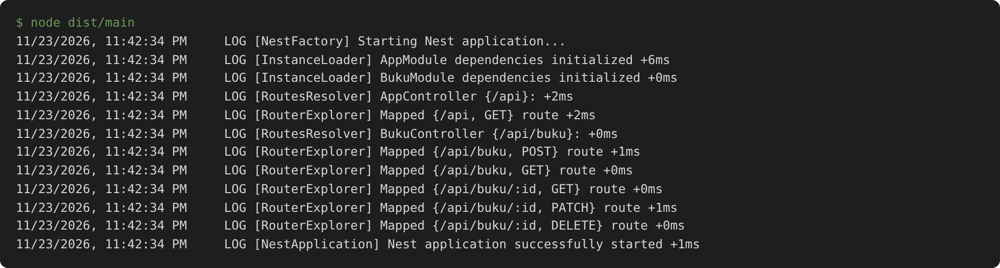

**Pengujian endpoint** (`backend/buku.http`)

| | |
|---|---|
| 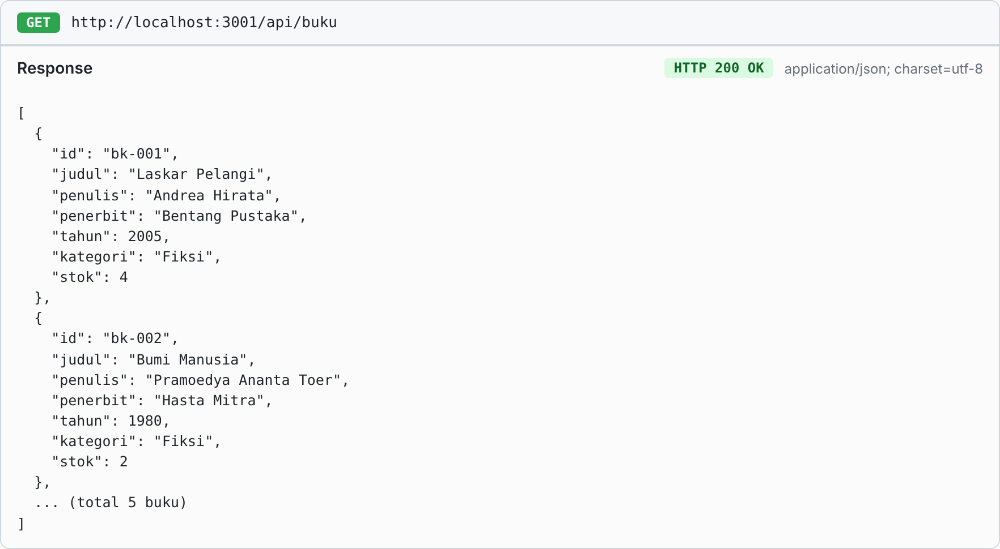 | 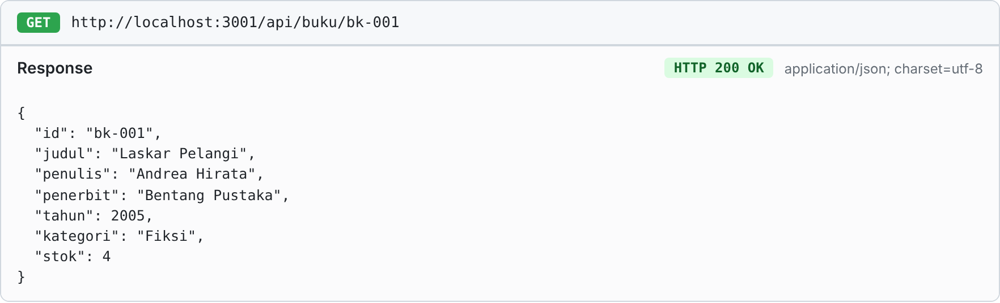 |
| 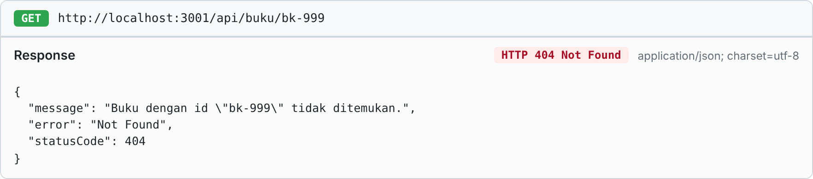 | 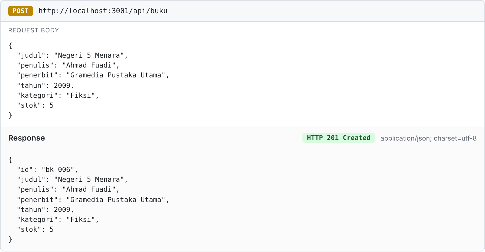 |
| 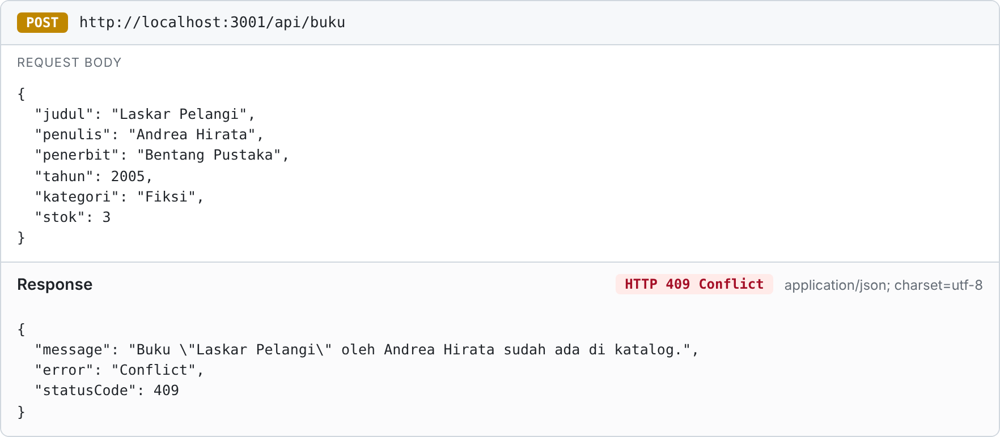 | 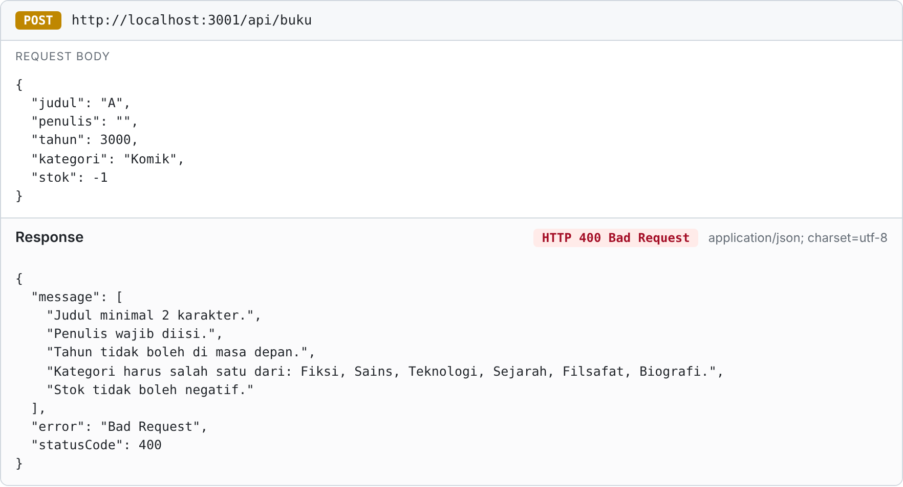 |
| 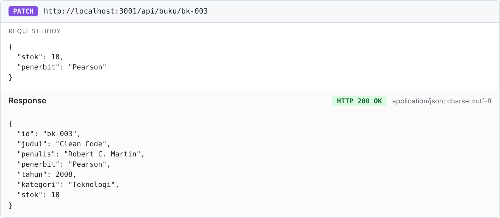 | 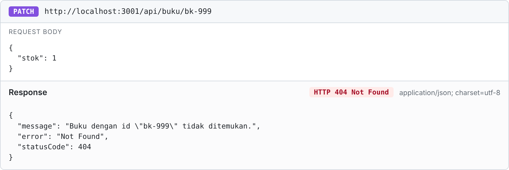 |
| 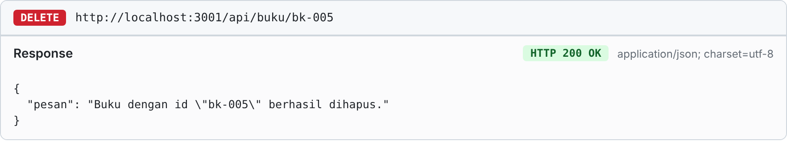 | 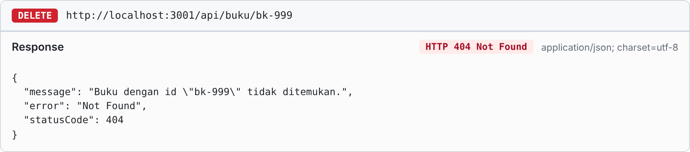 |

**Integrasi frontend**: tambah → ubah → hapus

| | |
|---|---|
| 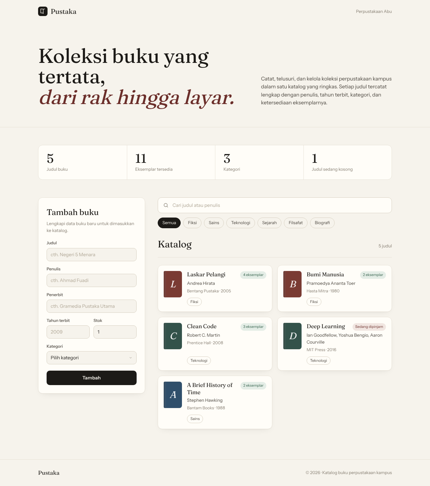 | 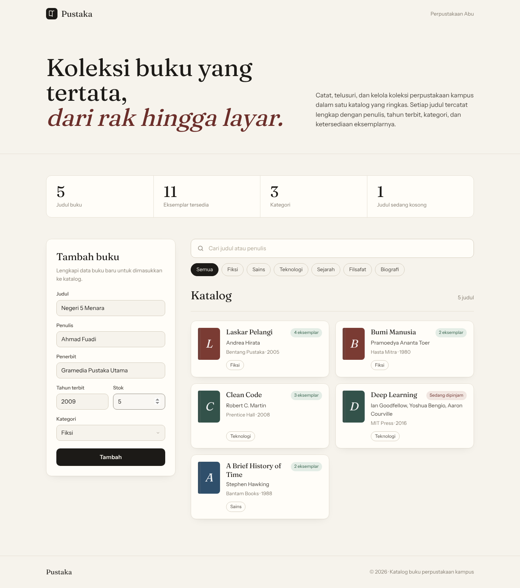 |
| 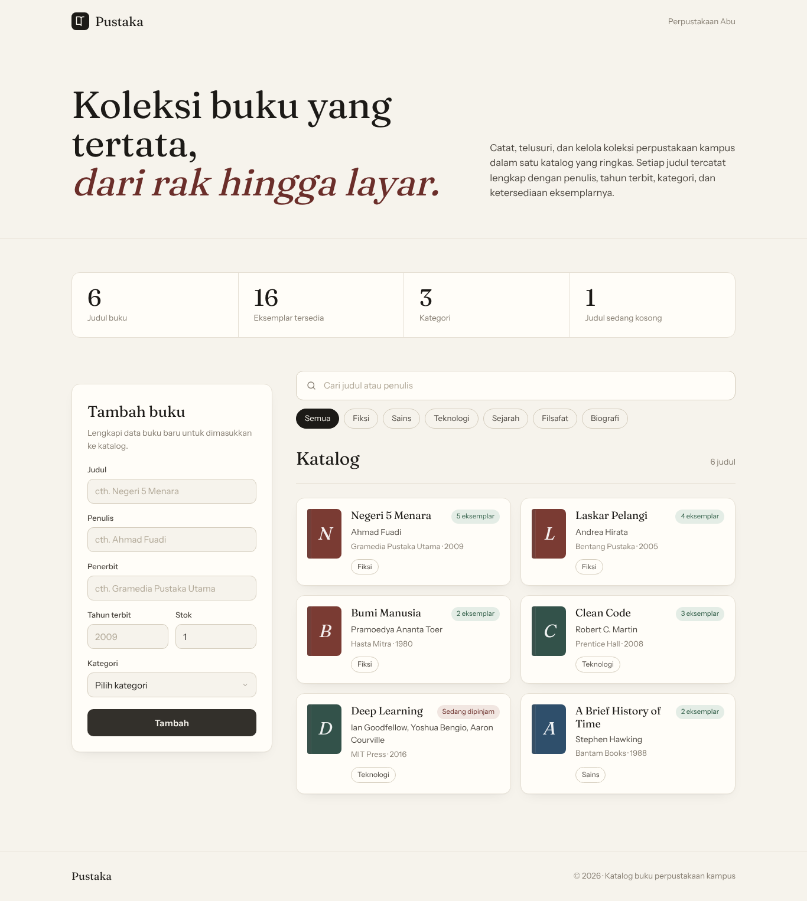 | 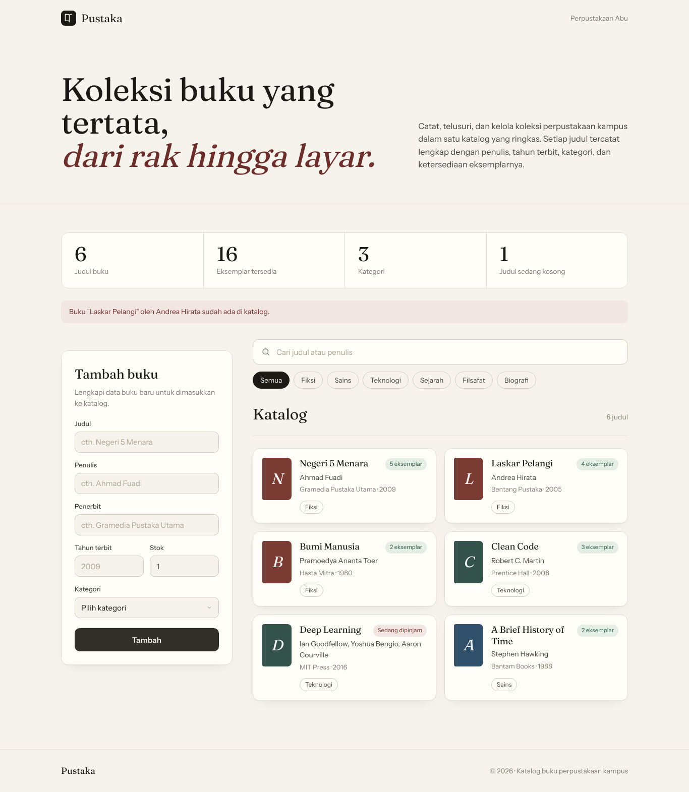 |
| 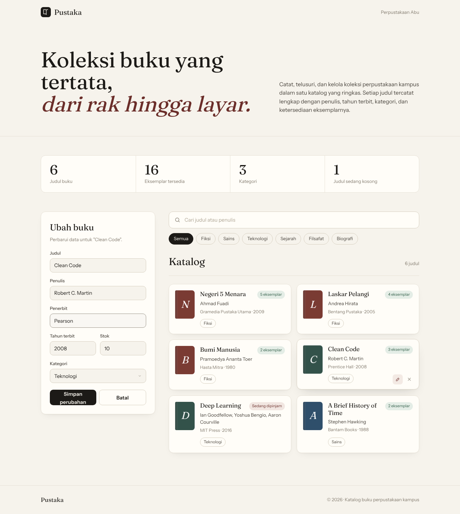 | 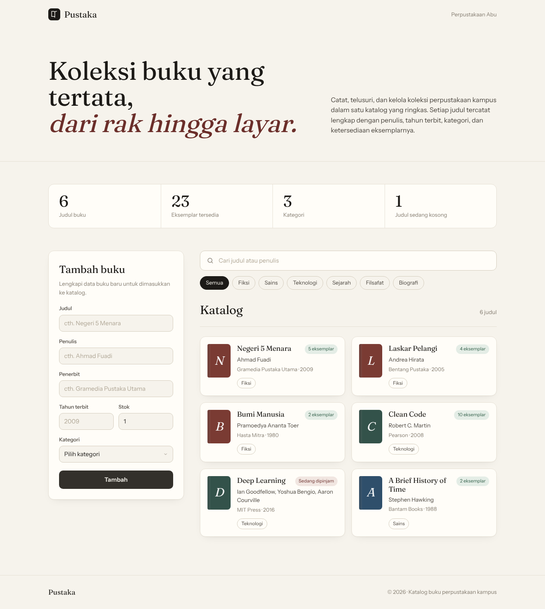 |
|  | 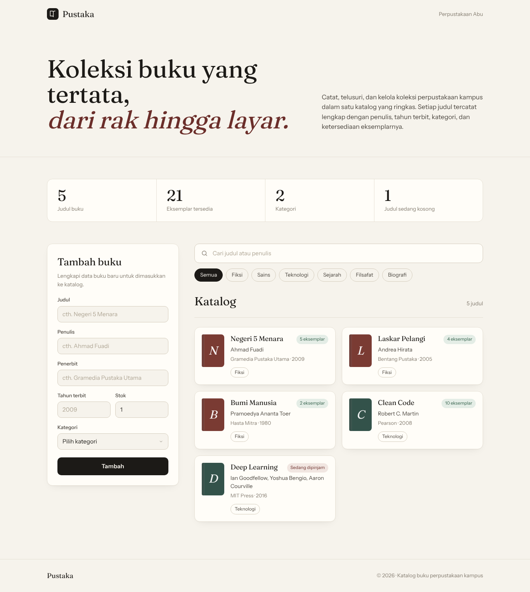 |
